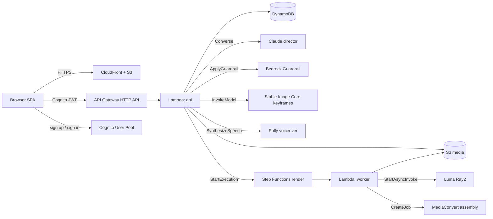

# Kyverin Studio

**Direct an AI film, shot by shot.** Describe an idea and an AI director writes a storyboard. The studio locks your characters and visual style, paints every keyframe, records a voiceover fitted to each shot, and plays the whole thing as an animatic. Then it renders only the shots you approve with Luma Ray2 on Amazon Bedrock and assembles the final film with captions and content credentials.

Fully serverless on AWS: no servers, no containers, nothing billed while idle.

> v2 is a ground-up rebuild of the original scaffold, which now lives in [`legacy/`](legacy/). The old Express/Prisma/Supabase/Railway code was never wired end to end. It also targeted Nova Reel, which AWS retired on 30 Sep 2026.

## What's new in v2 (2026 AI-video practice)

| Feature | How it works |
|---|---|
| **AI director** | Claude on Bedrock (Converse API with a forced tool call) produces a validated JSON storyboard: shots, durations, camera moves, keyframe and motion prompts, and narration timed to about 2.4 words/sec. |
| **Character & style lock** | A *style bible* and fixed *cast looks* are injected verbatim into every keyframe prompt with a shared per-project seed. Ray2 animates *from* those keyframes (image-to-video), so identity carries across shots. |
| **Seamless transitions** | Mark a shot `continuous` and Ray2 receives the next shot's keyframe as `frame1`, so the shot ends exactly where the next begins. |
| **Animatic first** | Keyframes + camera-move animation + voiceover play in the browser at final timing before any render credit is spent. |
| **Pay for changes only** | Each rendered clip is fingerprinted (prompt, keyframe, duration, resolution). Edit one shot and only that shot is re-rendered. |
| **Fitted voiceover & captions** | Amazon Polly neural voices in 9 languages. Each line is measured with SSML speech marks, sped up if needed, and padded with silence to the exact shot length. WebVTT and SRT captions are generated from the timings. |
| **Bring your own frame** | Upload a JPEG (product shot, owned character art) as any shot's keyframe. |
| **Guardrails** | Amazon Bedrock Guardrails (content filters, prompt-attack filter, denied topics for real-person deepfakes and election misinformation) on prompts and storyboards. Stable Image's own filter is also respected. |
| **Cost controls** | Credit ledger with atomic reservations, refunds for failed shots, render access limited to admins by default, a hard monthly render cap enforced in DynamoDB, and an AWS Budgets email alarm. |
| **Content credentials** | Each final MP4 ships with a C2PA-style provenance manifest: models, prompts, `trainedAlgorithmicMedia` source type, and the file's SHA-256. |

## Architecture



The render workflow runs shots in parallel (Map, concurrency 2) with polling, throttling retries, per-shot failure isolation and a timeout on stuck jobs. It then stitches clips and voiceover in MediaConvert and writes the captions and provenance manifest. Any failure path ends in `Finalize`, which refunds the credits for anything that was not produced.

## Costs (us-west-2, Nov 2026)

| Step | AWS cost | Credits (1 credit ≈ $0.10) |
|---|---|---|
| Storyboard (Claude) | < $0.05 | 1 |
| Keyframe (Stable Image Core) | ≈ $0.04 | 1 |
| Voiceover (Polly neural) | fractions of a cent | free |
| Ray2 shot, 5 s @ 540p / 720p | $3.75 / $7.50 | 38 / 75 |
| Ray2 shot, 9 s @ 540p / 720p | $6.75 / $13.50 | 68 / 135 |
| Assembly (MediaConvert) | ≈ $0.01 | 1 |

Idle cost is near zero: DynamoDB on-demand, Lambda, HTTP API and pennies of S3/CloudFront. Ray2 is the only expensive step, which is why the animatic-first workflow, render allowlist and monthly cap exist.

## Deploy

Prerequisites: an AWS account with Bedrock access in **us-west-2** (Anthropic Claude, Luma Ray2 and Stability models enabled; third-party models auto-subscribe on first use), and Python 3.10+ with `boto3`.

```bash
python infra/deploy.py --admin-email you@example.com --budget-email you@example.com
```

The script zips the Lambda code and picks the newest Claude Sonnet inference profile. It then creates or updates the CloudFormation stack (`infra/template.yaml`), writes `config.js`, uploads the site and prints the URL. Re-run it after any change. Remove everything with `--destroy`.

Useful flags: `--render-policy all` (let every user render; mind the cost), `--monthly-render-cap 100`.

## Develop

```bash
# backend unit + pipeline tests (no AWS needed, in-memory fakes)
cd backend && python -m unittest -v tests.test_studio

# frontend: serve statically; with no API configured it runs in demo mode
cd frontend && python -m http.server 8765   # http://localhost:8765/?demo#/studio
```

`frontend/demo.js` implements the same API offline, so the hosted site's **live demo** (`?demo`) can be explored without an account and without spending anything.

## Repository layout

```
backend/studio/   api.py (HTTP routes), director.py (Claude), media.py (keyframes, Polly, captions),
                  render.py (Step Functions steps, Ray2, MediaConvert, provenance), pricing.py, common.py
backend/tests/    fakes for DynamoDB/S3/Bedrock/Polly/SFN/MediaConvert + end-to-end pipeline tests
frontend/         index.html, styles.css, app.js (SPA, Cognito auth without SDK), demo.js
infra/            template.yaml (CloudFormation), deploy.py
legacy/           the original v1 scaffold, kept for reference
```

Built by Kevin under **Kyverin**.
